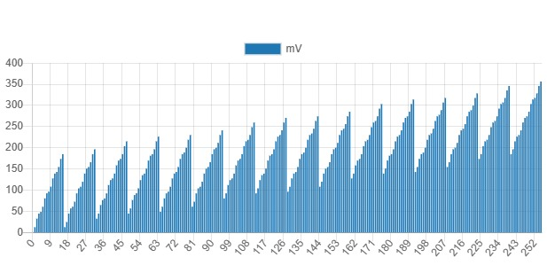
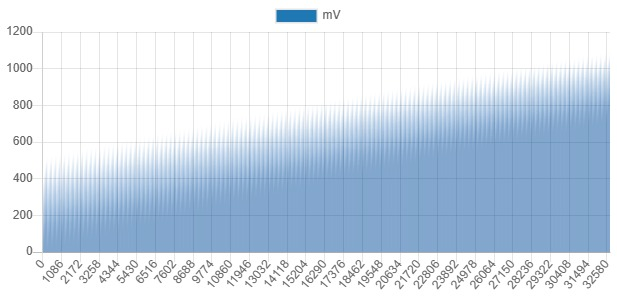
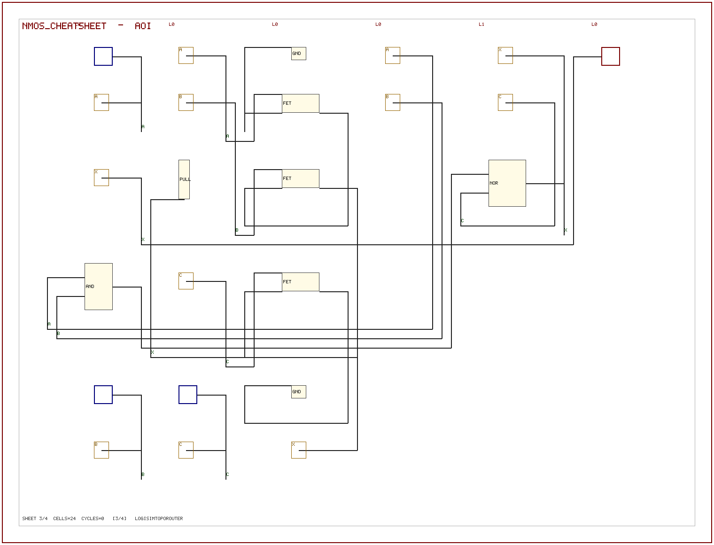

# Scripts

Various scripts, to automate the chip researcher's activities.

## APU_DAC_Generator

APU DAC table generator, separately for AUX A/B channels.

Produced by simple calculations based on the internal resistance of the APU DAC transistors and external resistance on the motherboard.

|||
|---|---|

:warning: A simplified FET model with linear resistance is used. Actually there is some tricky formula with cubic relationship to input voltage, but for low voltages this will do.

To run:
```
python3 APU_DAC_Generator.py
```

## bin2hex

A script to convert a binary file into HEX Logisim format (+modified version that works with 32-bit data).

## TopoShredder

A script for slicing the topology/tran pictures into small pieces. I'm tired of doing it by hand every time.

To run:
```
python3 TopoShredder.py -apu
python3 TopoShredder.py -ppu
```

## LogisimTopoRouter

A script for topological sorting (re-planning) of Logisim / Logisim-evolution schematics (issue #1391).

It reads a `.circ` project, rebuilds its netlist, topologically sorts every schematic it contains and
writes back:

* a **re-routed `.circ`** with the cells placed in topological columns (primary inputs on the left,
  primary outputs on the right) and every net drawn through dedicated vertical lanes and horizontal
  tracks - the layout of an FPGA/ASIC channel router. If the source project holds several circuits,
  all of them are re-planned, i.e. the output is an **atlas** of sheets;
* a **PNG picture** of every sheet in a Xilinx PlanAhead-like style (white sheet, dark red frame,
  pale logic cells, blue memory cells, black wires, blue inputs, dark red outputs, level headers);
* a **declarative Verilog** netlist (one module per Logisim circuit) with a small primitive library;
* **statistics** on the console: how many cells, which cells (by type), how many cycles
  (cyclic groups are reported per schematic), plus the input and output signal tables.

To run:
```
python3 LogisimTopoRouter.py 6502.circ                       # -> 6502_topo.circ, .v, .png
python3 LogisimTopoRouter.py Logisim/2C0x_PPU.circ -o out/
python3 LogisimTopoRouter.py 6502.circ --no-route            # analysis only
python3 LogisimTopoRouter.py 6502.circ --verify --json stats.json
```

Options that matter:

| option | meaning |
|---|---|
| `-o DIR` | where to put the generated files (default: next to the input) |
| `--circuit NAME` | only process the named circuit (repeatable) |
| `--atlas` | force atlas behaviour for a single-circuit project |
| `--no-route` | analysis only (no `.circ`/`.v`/`.png`) |
| `--no-circ`, `--no-verilog`, `--no-png` | skip individual outputs |
| `--png-scale N` | pixels per Logisim grid unit in the PNG (default 2) |
| `--verify` | re-read the generated `.circ` and check that the netlist survived the round trip |
| `--json FILE` | machine readable statistics |
| `--style FILE` | style JSON (default `LogisimTopoRouter.style.json` next to the script) |

The graphical style lives in `LogisimTopoRouter.style.json`: sheet frame and title block, colours,
fonts, spacing (`column_pitch`, `row_pitch`, `max_rows`), PNG scale, and the Verilog options. Copy the
file, edit it and pass it with `--style`.

Notes on the implementation (verified against the Logisim 2.7.1 and logisim-evolution 3.8.0 sources):

* both dialects write `<project version="1.0" source="...">`; the dialect is discriminated by
  `source=`, and the generated file keeps the dialect of its input;
* wires connect **only** where a wire endpoint coincides exactly with another wire endpoint or with a
  component pin (a crossing never connects), which is how the netlist is rebuilt;
* pin geometry comes from the real Logisim formulas (gates, wiring, plexers, arithmetic, memory, I/O);
  sub-circuit boxes are taken from the referenced circuit's appearance (`<appear>`, including its
  `circ-port`/`circ-anchor` entries) so that a sub-circuit's pins land exactly where Logisim expects
  them; anything unknown falls back to reading the pins off the drawing;
* **Logisim has no bidirectional (Bidir) ports.** A net that carries both an external input pin and an
  internal driver (i.e. one that would need an `inout` in Verilog) is reported, and in the Verilog it
  is split into separate `<name>_i` / `<name>_o` ports instead of an `inout`;
* `--verify` re-parses the routed file and compares its netlist with the input's. All twelve projects in
  this repository (6502, 2C02/6538, 2A03, the `Logisim/Evolution` variants, `NMOS_CheatSheet` - 535
  circuits in total) round-trip with an identical netlist;
* sheets can be very wide: the columns are folded automatically (`layout.max_rows` in the style file)
  to keep a usable aspect ratio, and huge PNGs are scaled down to stay below `png.max_pixels`.

Example (the `AOI` sheet of `Logisim/NMOS_CheatSheet.circ`):



